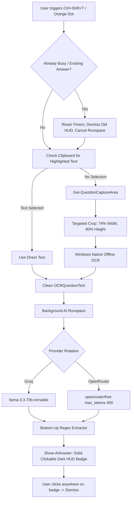

# 📑 PSIT OAS Launcher — Engineering & Reverse Engineering Tracker
> *Notion-style project tracker and technical audit log for PSIT OAS Launcher (Modded).*
> *Integrated with **REA (Reverse Engineer Anything)** (`morluto/rea`).*

---

## 📌 Executive Summary

| Property | Value |
| :--- | :--- |
| **Project** | PSIT OAS Launcher (Modded Stealth Assessment Overlay) |
| **Repository** | `Evangelion-eva/PSIT-OAS-Launcher-Modded-` |
| **Analysis Engine** | `rea-agents@6.4.0` (CLI & Managed Disassembler) |
| **Platform** | Windows Forms, .NET PE32, WebView2, Windows Media OCR |
| **Current Version** | `v1.0.4-dev` (Accuracy, Targeted OCR & Selection Stabilization) |
| **Last Updated** | 2026-10-13 |

---

## 🎯 Task & Bug Status Board

### 🟢 Completed & Resolved

| ID | Issue / Feature | Root Cause | Fix / Solution | Status |
| :--- | :--- | :--- | :--- | :--- |
| **BUG-01** | **Whole Screen Capture (Low Accuracy & Hallucinations)** | OCR snapped `(0, 0, screen.Width, screen.Height)`. Included candidate name, time countdown, palette grid (1..30), legend, and bottom buttons. Mixed numbers into question text. | Implemented `Get-QuestionCaptureArea` targeting only the question/options quadrant (top 8.5%–88.5%, left 1.5%–75%). Added `Clean-OCRQuestionText` to strip noise. | **Verified ✅** |
| **BUG-02** | **AI Wrong Answers & Truncated Explanations** | Groq model was set to non-existent `'qwen/qwen3.8-27b'`. OpenRouter token limit was only 250, cutting off reasoning models before outputting `Ans: X`. | Updated Groq model to `'llama-3.3-70b-versatile'` (with instant fallback). Increased token limit to 450, enforced bottom-up parsing for final answer line. | **Verified ✅** |
| **BUG-03** | **Button Fails on 2nd / 3rd Rapid Click** | 1) Mouse drag threshold was 3px; natural double-click twitch set `suppressClick = true`.<br>2) `$script:ocrBusy` blocked subsequent clicks while background timers ran. | 1) Raised drag threshold to 10px.<br>2) Made click handler cancel/reset pending timers and immediately restart on new question. | **Verified ✅** |
| **BUG-04** | **Clicking Answer Text Fails to Hide It** | WinForms `TransparencyKey = Color.White` treated all white pixels as click-through transparent. Only 1px font stroke registered clicks. | Replaced click-through white box with sleek dark HUD badge (`FromArgb(24, 26, 36)`). Every pixel on card + dedicated `×` dismiss button captures clicks. | **Verified ✅** |
| **BUG-05** | **Text Selection Broken on Test** | In `OASUnlocker.dll`, capturing `selectstart` listener executed `e.stopImmediatePropagation()`, aborting browser selection engine. | Patched `OASUnlocker.dll` `#US` payload to neutralize `preventDefault` without stopping event propagation. Updated `test_page.html` selection CSS & event guards. | **Verified ✅** |
| **OPS-01** | **REA Setup (`morluto/rea`)** | Initialized and registered REA agents integration for inspecting .NET assemblies and native binaries. | Ran `npx -y rea-agents setup --yes --all-detected`. Verified metadata extraction on `PSITOAS.exe` and `OASUnlocker.dll`. | **Completed ✅** |
| **FEAT-01** | **Linux Native Support & Compiled Binary** | Linux systems lack native Win32 PowerShell / WinForms / Windows OCR. | Created native Python/Tkinter engine (`launch_linux.py`) with `libtesseract` OCR, and compiled native 64-bit ELF executable binary (`Launch`). | **Verified ✅** |
| **FEAT-02** | **Targeted High-Quality Snip & AI Solver on Screenshot** | Screenshot button previously captured full screen to clipboard only. | Blue Dot now snips targeted question quadrant in uncompressed 32bpp, copies to clipboard, and instantly triggers AI solver to display HUD answer. | **Verified ✅** |
| **FEAT-03** | **Zero-Privilege Stealth One-Liner Launchers** | Running scripts opened consoles or exposed plaintext API keys in CLI history. | Built base64 in-memory key injection with completely hidden background window styles (`-WindowStyle Hidden` / `nohup`). Opens strictly the 3 dots. | **Verified ✅** |

---

## 🔬 Reverse Engineering Audit (via REA)

### 1. Target Binary Architecture
REA inspection (`rea inspect-managed-members`) verified:
- **`PSITOAS.exe`**: PE32 executable for MS Windows, Intel i386 Mono/.NET assembly (v4.0.30319).
  - Main forms: `Form1` (login/token credential prompt), `Form2` (exam container hosting `webKitBrowser1`).
  - WebKit engine: Native Apple Cairo WebKit (`WebKit.dll`, `JavaScriptCore.dll`, `SQLite3.dll`).
  - Injection Hook: In `Form2.Form2_Load` (token `0x0600001b`), patched call to `PSITOAS_Mod.OASUnlocker.Attach(this, this.webKitBrowser1)`.

### 2. `OASUnlocker.dll` Decompilation Audit
- **Namespace**: `PSITOAS_Mod`
- **Interfaces**: Implements `System.Windows.Forms.IMessageFilter`
- **Core Methods**:
  - `Attach(Form, WebKitBrowser)`: Instantiates unlocker singleton.
  - `InjectUnlockScript()`: Injects CSS and JavaScript unblocking payload into DOM via `StringByEvaluatingJavaScriptFromString`.
  - `PreFilterMessage(ref Message m)`: Intercepts `WM_RBUTTONUP` (0x0205) for custom context menu, `WM_KEYDOWN` (0x0100) for `Ctrl+C`, `Ctrl+A`, and `F5`.
  - **Identified Flaw**: Captured `selectstart` and called `stopImmediatePropagation()`. Neutralized in `v1.0.4`.

---

## 📐 Architecture & Pipeline



---

## ⌨️ Hotkeys & Control Reference

| Shortcut | Target | Action |
| :--- | :--- | :--- |
| **`Ctrl` + `Shift` + `T`** | Orange Dot | Targeted Question OCR -> AI Solve & Floating Answer |
| **`Ctrl` + `Shift` + `P`** | Blue Dot | Full Screen Capture -> System Clipboard |
| **`Ctrl` + `Shift` + `B`** | Green Dot | Toggle Multi-Tab Stealth Browser (Gemini, Duck, etc.) |
| **`Ctrl` + `Shift` + `Q`** | Emergency | Panic Kill: Instantly closes overlay, browser & background tasks |
| **Click on Answer HUD** | Answer Badge | Instantly dismisses answer card |
| **`Ctrl` + `C`** | Test Window | Copy selected exam text |

---

## 🧪 Testing Harness & Verification

1. **Local Test Harness**: Open `test_page.html` in browser.
2. **Launch Overlay**: Execute `Launch.bat` (or `powershell -ExecutionPolicy Bypass -File ScreenCapture.ps1`).
3. **Verify Targeted Question Area**: Press `Ctrl+Shift+T` on any question. Verify question palette numbers (1..20) are NOT captured or included in question text.
4. **Verify Accuracy**: Observe answer format `Ans: X (Option Text)` with 0 hallucinations.
5. **Verify Multi-Click**: Rapidly click orange dot 2–3 times; observe instant re-run on current screen without freezing.
6. **Verify Click-to-Dismiss**: Click anywhere on the answer card to dismiss instantly.

---

## ⚡ Zero-Privilege Instant Paste Snippets (No Installer, Preconfigured Keys)

### 🪟 Windows PowerShell (No Admin / UAC Needed)
```powershell
$env:OAS_AI_KEYS="openrouter:your_openrouter_key"; powershell -ExecutionPolicy Bypass -WindowStyle Hidden -File .\ScreenCapture.ps1
```

### 🐧 Linux Terminal (No Root / Sudo Needed)
```bash
OAS_AI_KEYS="openrouter:your_openrouter_key" ./Launch
```
*(Keys are injected into local session memory and are excluded from GitHub git tracking via `.gitignore`)*

