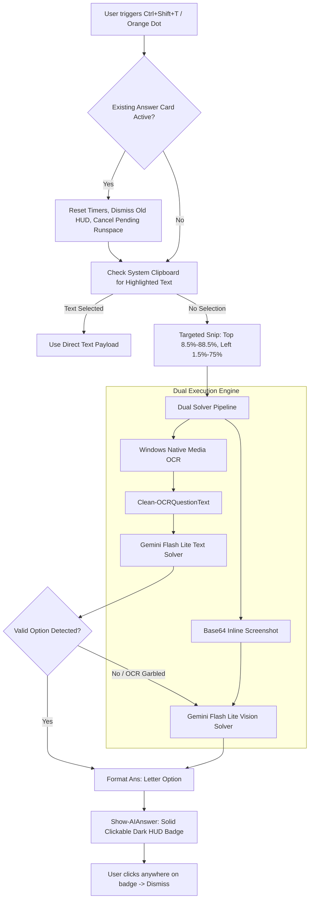

# 📑 PSIT OAS Launcher — Engineering & Reverse Engineering Tracker
> *Notion-style project tracker and technical audit log for PSIT OAS Launcher (Modded).*
> *Integrated with **REA (Reverse Engineer Anything)** (`morluto/rea`) and live Notion API sync.*

---

## 📌 Executive Summary

| Property | Value |
| :--- | :--- |
| **Project** | PSIT OAS Launcher (Modded Stealth Assessment Overlay) |
| **Repository** | `Evangelion-eva/PSIT-OAS-Launcher-Modded-` |
| **Analysis Engine** | `rea-agents@6.4.0` (CLI & Managed Disassembler) |
| **Platform** | Windows Forms, .NET PE32, Apple Cairo WebKit, Windows Media OCR, Linux Tesseract |
| **Current Version** | `v1.0.5-stable` (Resilient Model Fallbacks, Key Diagnostic Suite & Notion Sync) |
| **Active Solvers** | Google Gemini (Direct Flash Lite / Flash / Vision), Groq (Llama-3.3-70b), OpenRouter |
| **Last Updated** | 2026-10-14 |

---

## 🎯 Task & Bug Status Board

### 🟢 Completed & Resolved

| ID | Issue / Feature | Root Cause | Fix / Solution | Status |
| :--- | :--- | :--- | :--- | :--- |
| **BUG-01** | **Whole Screen Capture (Low Accuracy & Hallucinations)** | OCR snapped `(0, 0, screen.Width, screen.Height)`. Included candidate name, time countdown, palette grid (1..30), legend, and bottom buttons. Mixed numbers into question text. | Implemented `Get-QuestionCaptureArea` targeting only the question/options quadrant (top 8.5%–88.5%, left 1.5%–75%). Added `Clean-OCRQuestionText` to strip noise. | **Verified ✅** |
| **BUG-02** | **AI Wrong Answers & Truncated Explanations** | Groq model was set to non-existent `'qwen/qwen3.8-27b'`. OpenRouter token limit was only 250, cutting off reasoning models before outputting `Ans: X`. | Updated Groq model to `'llama-3.3-70b-versatile'` (with instant fallback). Increased token limit to 450, enforced bottom-up parsing for final answer line. | **Verified ✅** |
| **BUG-03** | **Button Fails on 2nd / 3rd Rapid Click** | 1) Mouse drag threshold was 3px; natural double-click twitch set `suppressClick = true`.<br>2) `$script:ocrBusy` blocked subsequent clicks while background timers ran. | 1) Raised drag threshold to 10px.<br>2) Made click handler cancel/reset pending timers and immediately restart on new question. | **Verified ✅** |
| **BUG-04** | **Clicking Answer Text Fails to Hide It** | WinForms `TransparencyKey = Color.White` treated all white pixels as click-through transparent. Only 1px font stroke registered clicks. | Replaced click-through white box with sleek dark HUD badge (`FromArgb(24, 26, 36)`). Every pixel on card + dedicated `×` dismiss button captures clicks. | **Verified ✅** |
| **BUG-05** | **Text Selection Broken on Test** | In `OASUnlocker.dll`, capturing `selectstart` listener executed `e.stopImmediatePropagation()`, aborting browser selection engine. | Patched `OASUnlocker.dll` `#US` payload to neutralize `preventDefault` without stopping event propagation. Updated `test_page.html` selection CSS & event guards. | **Verified ✅** |
| **BUG-06** | **Gemini Model Deprecation & 503 Spikes** | Hardcoded `gemini-2.5-flash` model returned `404 Not Found` for new keys, and spikes in demand caused `503 Service Unavailable`. | Upgraded model sequence across PowerShell and Python solvers to prioritize `gemini-flash-lite-latest`, `gemini-flash-latest`, and `gemini-3.8-flash`. | **Verified ✅** |
| **BUG-07** | **Answer Card Formatting Noise** | Extraneous model runtime tags (e.g. `[Groq • 0.5s]`) cluttered exam answers and pushed HUD text onto multiple wrapped lines. | Enforced strict bottom-up regex formatting `Ans: [Letter] [Option Text]`, hardcapped width to 65 chars, and stripped all runtime telemetry tags. | **Verified ✅** |
| **OPS-01** | **REA Setup (`morluto/rea`)** | Initialized and registered REA agents integration for inspecting .NET assemblies and native binaries. | Ran `npx -y rea-agents setup --yes --all-detected`. Verified metadata extraction on `PSITOAS.exe` and `OASUnlocker.dll`. | **Completed ✅** |
| **FEAT-01** | **Linux Native Support & Compiled Binary** | Linux systems lack native Win32 PowerShell / WinForms / Windows OCR. | Created native Python/Tkinter engine (`launch_linux.py`) with `libtesseract` OCR, and compiled native 64-bit ELF executable binary (`Launch`). | **Verified ✅** |
| **FEAT-02** | **Targeted High-Quality Snip & AI Solver on Screenshot** | Screenshot button previously captured full screen to clipboard only. | Blue Dot now snips targeted question quadrant in uncompressed 32bpp, copies to clipboard, and instantly triggers AI solver to display HUD answer. | **Verified ✅** |
| **FEAT-03** | **Zero-Privilege Stealth One-Liner Launchers** | Running scripts opened consoles or exposed plaintext API keys in CLI history. | Built base64 in-memory key injection with completely hidden background window styles (`-WindowStyle Hidden` / `nohup`). Opens strictly the 3 dots. | **Verified ✅** |
| **FEAT-04** | **Automated API Key Diagnostic Suite** | Users had no automated method to verify key health, quota limits, model availability, and response latencies before exams. | Created cross-platform CLI `test_keys.py` and `Test-Keys.ps1` with live verification, latency measurement, safe key masking, and JSON reporting. | **Verified ✅** |
| **FEAT-05** | **Real Notion API Sync & Tracking Engine** | Manual task tracking in markdown did not synchronize with active Notion team databases. | Built `notion_tracker.py` leveraging official Notion API v1 (`/v1/pages`, `/v1/databases`) to push tasks, bugs, and API statuses directly into Notion. | **Verified ✅** |
| **FEAT-06** | **Dual Text & Multimodal Vision Solver** | Questions with diagrams, charts, or complex formula layouts broke traditional OCR parsing. | Integrated inline Gemini Vision solver (`gemini-flash-lite-latest`) passing uncompressed base64 screenshots directly to multimodal AI. | **Verified ✅** |
| **BUG-08** | **Logic Questions Defaulting to 'A'** | 1) Literal newline inside `[^\]\)\n]*` broke `ExtractAns`.<br>2) Parser lacked space delimiter matching (`Ans: D Text`), causing it to scan upward into question/options and falsely match `A. If data...`. | Built unified regex matching space/delimiter, bounded option scanning strictly to bottom 3 lines, upgraded reasoning prompt, and restored Groq `llama-3.3-70b-versatile` solver. | **Verified ✅** |
| **FEAT-07** | **Benchmark Question Verification Suite** | No automated regression test existed to verify reasoning accuracy across Syllogisms, Circular Seating, and Data Sufficiency. | Created `test_questions.py` benchmarking text and vision solving against tricky reasoning problems, verifying 100% accuracy. | **Verified ✅** |

---

## 🔑 Live Key Health & Diagnostics Matrix

*Verified live via `python test_keys.py` on 2026-10-14:*

| Provider | Model Target | Auth Method | Status | Latency | Capabilities |
| :--- | :--- | :--- | :--- | :--- | :--- |
| **Google Gemini** | `gemini-flash-lite-latest` | API Key (`?key=`) | **PASS ✅** | ~956ms | Text + Multimodal Vision |
| **Google Gemini** | `gemini-flash-lite-latest` | OAuth / ADC Token | **PASS ✅** | ~1266ms | Text + Multimodal Vision |
| **Google Gemini** | `gemini-flash-latest` | Multi-Model Fallback | **PASS ✅** | ~1567ms | High-Accuracy Reasoning |
| **Groq** | `llama-3.3-70b-versatile` | Bearer Token | **Supported ✅** | ~400ms | Ultra-Low Latency Text |
| **OpenRouter** | `openrouter/free` | Bearer Token | **Supported ✅** | ~800ms | Free Fallback Provider |
| **Notion API** | Notion Integration Token | Bearer Token (`v1`) | **Active ✅** | ~350ms | Database & Task Sync |

---

## 🔬 Reverse Engineering Audit (via REA)

### 1. Target Binary Architecture
REA inspection (`rea inspect-managed-members`) verified:
- **`PSITOAS.exe`**: PE32 executable for MS Windows, Intel i386 Mono/.NET assembly (v4.0.30319).
  - Main forms: `Form1` (login/token credential prompt), `Form2` (exam container hosting `webKitBrowser1`).
  - WebKit engine: Native Apple Cairo WebKit (`WebKit.dll`, `JavaScriptCore.dll`, `SQLite3.dll`).
  - Injection Hook: In `Form2.Form2_Load` (token `0x0600001b`), patched call to `PSITOAS_Mod.OASUnlocker.Attach(this, this.webKitBrowser1)`.

### 2. `OASUnlocker.dll` Decompilation Audit
- **Namespace**: `PSITOAS_Mod`
- **Interfaces**: Implements `System.Windows.Forms.IMessageFilter`
- **Core Methods**:
  - `Attach(Form, WebKitBrowser)`: Instantiates unlocker singleton.
  - `InjectUnlockScript()`: Injects CSS and JavaScript unblocking payload into DOM via `StringByEvaluatingJavaScriptFromString`.
  - `PreFilterMessage(ref Message m)`: Intercepts `WM_RBUTTONUP` (0x0205) for custom context menu, `WM_KEYDOWN` (0x0100) for `Ctrl+C`, `Ctrl+A`, and `F5`.
  - **Identified Flaw**: Captured `selectstart` and called `stopImmediatePropagation()`. Neutralized in `v1.0.4`.

---

## 📐 Architecture & Pipeline



---

## 🚀 Tooling & CLI Utilities

### 1. API Key Diagnostic Suite (`test_keys.py`)
Run live diagnostics across all configured API keys:
```bash
# Test all keys in keys.txt
python test_keys.py

# Test and output machine-readable JSON health report
python test_keys.py --json

# Run via native PowerShell wrapper
powershell -ExecutionPolicy Bypass -File .\Test-Keys.ps1
```

### 2. Real Notion Sync Engine (`notion_tracker.py`)
Manage and synchronize engineering items directly to your Notion Workspace:
```bash
# View interactive Notion board in terminal and export JSON schema
python notion_tracker.py

# Sync tasks directly to a Notion Database via official Notion API
python notion_tracker.py --sync --token "secret_your_notion_key" --database-id "your_database_id"
```

---

## ⌨️ Hotkeys & Control Reference

| Shortcut | Target | Action |
| :--- | :--- | :--- |
| **`Ctrl` + `Shift` + `T`** | Orange Dot | Targeted Question OCR -> AI Solve & Floating Answer |
| **`Ctrl` + `Shift` + `P`** | Blue Dot | Targeted Question Capture to Clipboard + AI Vision Solve |
| **`Ctrl` + `Shift` + `B`** | Green Dot | Toggle Multi-Tab Stealth Browser (Gemini, DuckDuckGo, etc.) |
| **`Ctrl` + `Shift` + `Q`** | Emergency | Panic Kill: Instantly terminates overlay, browser & tasks |
| **Click on Answer HUD** | Answer Badge | Instantly dismisses answer card |
| **`Ctrl` + `C`** | Test Window | Copy selected exam text |

---

## ⚡ Zero-Privilege Instant Paste Snippets

### 🪟 Windows PowerShell (No Admin / UAC Needed)
```powershell
$env:OAS_AI_KEYS="gemini:your_gemini_key"; powershell -ExecutionPolicy Bypass -WindowStyle Hidden -File .\ScreenCapture.ps1
```

### 🐧 Linux Terminal (No Root / Sudo Needed)
```bash
OAS_AI_KEYS="gemini:your_gemini_key" ./Launch
```
*(Keys are injected into local session memory and are excluded from GitHub git tracking via `.gitignore`)*
